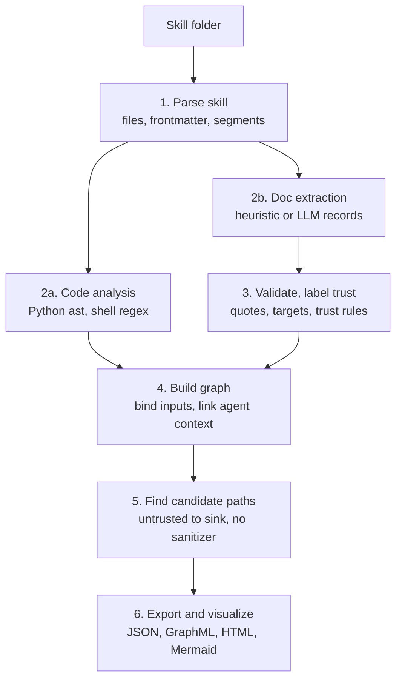

# skill2graph

`skill2graph` builds a **Skill Flow Graph** from an LLM agent *skill* folder (`SKILL.md` +
optional `scripts/` and `references/`). The graph is a static, taint-style data-flow model
used as a **candidate generator** in a study of *vulnerable (not malicious)* skills: benign
skills where untrusted data (repository file names, web content, issue text, script output)
can reach sensitive sinks (shell, network, agent config writes, skill triggers). Every
result is marked `status: "candidate"`; confirming it dynamically is out of scope here.

Code and documents are analyzed together. Code goes through a lightweight AST/regex taint
pass. Documents go through an instruction extractor (heuristic by default, LLM optional).
The two halves are joined through script argument bindings and a single **AgentContext**
node that stands for the agent's working context.

## Graph model

### Nodes

| Type | Key attributes | Meaning |
|---|---|---|
| `Artifact` | `kind: code\|doc`, `path`, `lang` | A file of the skill |
| `Source` | `trust: trusted\|untrusted\|secret`, `found_in: code\|doc\|environment`, `category`, `evidence` | Where data enters. Categories: `constant`, `user_prompt`, `workspace_file_name`, `workspace_file_content`, `web_content`, `external_text`, `env_secret`, `env_var`, `other_script_output`, `previous_output`, `environment_content` |
| `Operator` | `in: code\|doc`, `role: sink\|sanitizer\|neutral`, `sink_category`, `evidence` | Something that acts on data. Sinks: `shell_exec`, `code_eval`, `network_egress`, `file_write`, `agent_config_write`, `skill_trigger`, `context_output`. Script input ports (`argv[1]`, `--url`, `stdin`) are neutral operators with `operator_kind=script_input` |
| `AgentContext` | `holds_untrusted`, `holds_secret`, `label_sources`, `future_sessions` | Exactly one per graph. Its labels are the union of the trust labels of every Source that reaches it over flow edges (sanitizers block the labels) |

Node ids are stable (`n1`, `n2`, …) and follow a deterministic build order.

### Edges (`etype`)

| Edge | Between | Attributes | Used in path queries? |
|---|---|---|---|
| `refers` | Artifact → Artifact (doc→doc, doc→code, code→code) | `binds`, e.g. `<filename> -> argv[1]` | no |
| `defines` | Artifact → Source/Operator inside it | (provenance only) | no |
| `flow` | Source/Operator/AgentContext → … | `certainty: deterministic\|extracted\|probabilistic`, `via` (`code`, `doc_instruction`, `stdout`, `llm_binding`, `trigger`, `persists`, `default_outflow`), optional `binds`, `filled_from`, `decided_by`, `breadth` | yes |

### Modelling rules

* Script `print`, logging, `echo`: `context_output` sink → `flow(deterministic, via=stdout)` → AgentContext.
* Doc operators that act on what the agent holds ("follow the steps", "use the output to run X `<arg>`"),
  and agent-chosen script arguments: flows **out of** AgentContext with `certainty=probabilistic`.
  `follow_content` is modelled as a `shell_exec` sink, because following setup steps means running commands.
* Script argument bindings: the `filled_from` phrase of each placeholder is classified by `trust.py`.
  Concrete origins (repo file names, a URL the user gives) become a doc `Source` with an `extracted` flow
  into the script's input port. Agent choices ("pick the branch …", unknown phrases) become
  `AgentContext → port` with `probabilistic` certainty and `via=llm_binding`.
* Writing an auto-loaded file (`CLAUDE.md`, `AGENTS.md`, `GEMINI.md`, `.cursorrules`, `.windsurfrules`,
  `copilot-instructions.md`, `.claude/…`, `.cursor/rules`, `.mcp.json`): `agent_config_write` sink plus a
  `persists` flow back into AgentContext (`future_sessions=True`). One node stands for both the current and
  future sessions.
* **Description trigger:** every skill gets a `skill_trigger` operator with a heuristic
  `breadth` score from 0 to 1. Broad words ("whenever", "any", "mentioned") raise it; "when the user asks"
  lowers it. The `AgentContext → trigger` flow (probabilistic, `via=trigger`) is only added when
  breadth ≥ 0.5.
* **Default environment source (explicit):** `environment content [untrusted]` → AgentContext
  (`default=True`) is added **only** when a document tells the agent to read or fetch environment data
  (files, pages, issues). Reading the skill's own `references/` or a script's printed output does not count.
* **Default network outflow (explicit):** when AgentContext holds a secret, a
  `agent generic tool use (network) [default]` sink with a probabilistic flow from the context is added
  (`default=True`). It stands for the agent's generic tool use, which is what the confluence query needs.
  Both defaults are drawn with dashed borders and flagged `uses_defaults` in path shapes.

## Pipeline (`src/skill2graph`)

### Build steps



Only step 2b can call an LLM, and only with `--llm`. Every other step is deterministic.
Steps 2a and 2b are independent and meet at step 4.

| Step | Module | Produces | Tools and libraries |
|---|---|---|---|
| 1. Parse skill | `parse_skill.py` | File list (code/doc/other), SKILL.md name and description, doc text split into line-numbered segments, code blocks, placeholders | `pathlib`, **PyYAML**, `re`, `shlex` |
| 2a. Code analysis | `code_analysis.py` | Script inputs (argv, flags, env), sensitive operators (sinks), sanitizers, data flows inside each script | Python **`ast`** (Python), `re` (shell), `abc` (`CodeAnalyzer` interface for a future Semgrep/CodeQL backend) |
| 2b. Doc extraction | `doc_extraction.py` | Instruction records: action, target, arguments and where each value comes from (`filled_from`), verbatim evidence | Heuristic: `re`, `shlex`. LLM (`--llm`): **openai** SDK → Azure AI Foundry, structured output with **pydantic** |
| 3. Validate, label trust | `validate.py`, `trust.py` | Records with fake quotes, unknown scripts or unknown placeholders removed; each data origin labeled trusted / untrusted / secret (unmatched phrases default to untrusted) | Plain Python, `re` (no LLM: validation checks the LLM, and trust labels must be reproducible) |
| 4. Build graph | `build.py` | Doc arguments bound to script inputs, script output linked into the Agent Context, trigger and persistence edges, context labels | **networkx** (`MultiDiGraph`) |
| 5. Find candidate paths | `query.py` | Ranked candidate paths and confluences (see below) | **networkx** |
| 6. Export and visualize | `export.py`, `visualize.py` | `graph.json`, `graph.graphml`, `paths.json`, interactive `graph.html`, `graph.mmd` | `json`, **networkx** (GraphML), **vis-network 9.1.9** (JavaScript, loaded from cdnjs) |
| CLI | `cli.py` | `skill2graph build \| paths \| batch` | `argparse`, `csv`, **python-dotenv** |

Installed packages: `networkx`, `pyyaml`, `openai`, `pydantic`, `python-dotenv`. The only external services are the
Azure OpenAI call (with `--llm`) and the vis-network script the HTML page loads when opened.

### Modules

| Module | Role |
|---|---|
| `parse_skill.py` | Inventories artifacts, parses SKILL.md frontmatter (PyYAML), splits the body into line-numbered prose and fenced-code segments, and finds placeholders (`<x>`, `{x}`, `$X`) and references to skill files, with the argv tokens that follow them |
| `code_analysis.py` | `CodeAnalyzer` interface. `PythonAstAnalyzer`: intra-file taint analysis over the stdlib `ast` module (argv/argparse/stdin ports, env and secret sources, file/web/subprocess-output sources, propagation through assignments, f-strings, concatenation, `.format`, method calls and same-file function calls; sinks; sanitizers `shlex.quote`, list-form `subprocess`, realpath plus `startswith` containment). `ShellRegexAnalyzer`: line-based checks for `$1`/`$@`, `$(curl …)`, `eval`, unquoted expansions, `echo`, redirects. Other languages are registered as artifacts with a warning |
| `doc_extraction.py` | Instruction records `{id, action, target, args[{slot, position, flag, filled_from}], input_from, evidence{file, lines, quote}, confidence}`. `HeuristicExtractor` is the default (offline, deterministic). `LLMExtractor` uses the OpenAI SDK against Azure AI Foundry with structured outputs (Pydantic `RecordsModel`) and only runs with `--llm` and the `.env` settings below |
| `validate.py` | Drops records whose quote is not verbatim in the file, whose script target does not exist, or whose action is unknown. Flags (and fixes) wrong line numbers, drops args whose slot is not a parsed placeholder, and marks args whose position or flag matches no script input as `unbound` |
| `trust.py` | Ordered rule table that maps `filled_from` phrases to a category and trust level, returning `decided_by: rule\|llm\|default` |
| `build.py` | Assembles the `networkx.MultiDiGraph`, binds doc instructions to script inputs (unmatched bindings are recorded in `binding_errors`, never guessed), adds the documented defaults, and computes the AgentContext labels |
| `query.py` | `candidate_paths`: untrusted Source → sink over flow edges only, with no sanitizer on the path, bounded length, and the best path kept per source/sink pair. Ranked by sink severity (`shell_exec`/`code_eval` > `agent_config_write` > `network_egress` > `file_write` > `skill_trigger` > `context_output`), then by fewest probabilistic edges. `confluence`: the context holds secret and untrusted data **and** has a probabilistic outflow to a network or shell sink |
| `export.py` | Node-link JSON (`edges` key, ids `n1…`, `e1…`) and GraphML (non-scalar attributes JSON-encoded) |
| `visualize.py` | A self-contained interactive HTML page (vis-network 9.1.9 from cdnjs, graph data embedded inline) with a candidate-path side panel (click to highlight), tooltips with evidence, a legend, and light/dark themes. Also a Mermaid `.mmd` export |
| `cli.py` | `skill2graph build | paths | batch` |

Path record format (`paths.json`):

```json
{"skill": "doc-converter", "id": "p1", "kind": "path", "path": ["n7", "n4", "n5"],
 "shape": {"source_category": "workspace_file_name", "sink_category": "shell_exec",
           "cross_modal": true, "probabilistic_edges": 0, "code_involved": true,
           "via_agent_context": false, "uses_defaults": false},
 "edges": [...], "evidence": [{"node": "n7", "file": "SKILL.md", "lines": [12, 12], "quote": "..."}],
 "severity": 0, "status": "candidate"}
```

## Candidate path types

### Two kinds of finding

| Kind | Definition |
|---|---|
| `path` | One chain from an **untrusted** source to any sink, or from a **secret** source to a leak sink (`context_output`, `file_write`, `agent_config_write`), with **no sanitizer** in between. Secrets are not reported for network/shell sinks, since skills legitimately send tokens to the APIs they call. Paths ending at `context_output` include the final hop into the Agent Context |
| `confluence` | The Agent Context holds **both a secret and untrusted content**, and has an outflow to a network or shell sink |

### Sink severity (ranking order)

| Severity | Sink |
|---|---|
| 0 (highest) | `shell_exec`, `code_eval` |
| 1 | `agent_config_write` |
| 2 | `network_egress` |
| 3 | `file_write` |
| 4 | `skill_trigger` |
| 5 (lowest) | `context_output` (untrusted or secret data printed into the agent's context) |

Within the same severity, paths with fewer probabilistic edges rank first, then shorter paths.

### Shape flags (on every path)

| Flag | Meaning |
|---|---|
| `source_category` | Where the data comes from (`workspace_file_name`, `web_content`, `other_script_output`, `env_secret`, …) |
| `source_trust` | `untrusted` or `secret` |
| `sink_category` | One of the sinks above |
| `cross_modal` | The path crosses from doc to code (or back) |
| `code_involved` | At least one script is on the path |
| `via_agent_context` | The path passes through the LLM's context |
| `probabilistic_edges` | How many steps depend on the LLM choosing to act (0 = certain) |
| `uses_defaults` | The path relies on an assumed default edge (generic environment source or network outflow) |

### Pattern types (T1–T7)

Every candidate gets a `pattern` field (`{"id", "name", "summary"}`), computed by `query.classify_pattern` from its
shape. Pattern types use **T** ids so they are never confused with path ids: `p1`, `p2`, … are a path's rank *within
one skill* (p1 = most severe), while `T1`–`T7` say *which kind* of path it is. The full catalog (explanation and graph
rule for each type) is in `PATTERNS` in `query.py`, in every `paths.json` as `pattern_catalog`, in the viewer's
"Pattern types" section, and in the `paths` CLI output.

| Type | Name | Graph rule (checked in this order) | Samples |
|---|---|---|---|
| T7 | Secret–untrusted confluence | confluence finding; or a path whose edge out of the context is the default network outflow | `gh-helper` (c1, p1) |
| T6 | Exposure | sink is `context_output`, or a secret reaches `file_write` | most samples' "→ print → Agent context" path; `gh-helper` p2 (`GITHUB_TOKEN`); `log-triage` p2 (`SENTRY_TOKEN` → report) |
| T5 | Trigger over-breadth | sink is `skill_trigger` | `deploy-helper` p2–p4 |
| T4 | Untrusted persistent write | sink is `agent_config_write` | `project-bootstrap` p1, `docs-site-sync` p1 |
| T3 | LLM-mediated chaining | passes through the context; the edge leaving it is an `llm_binding` into a script input | `git-tools` p1, `release-notes` p1 |
| T2 | Data-to-instruction promotion | passes through the context; the edge leaving it goes to a doc operator (e.g. "follow the steps") | `web-research` p1 |
| T1 | Direct taint flow | does not pass through the context (doc → script argument → sink, or code-only) | `doc-converter` p1, `log-triage` p1, `deploy-helper` p1 |

Caveats:
- T6 appears in almost every skill that prints anything, and paths with `uses_defaults=True` depend on assumed
  edges. Report them separately (or filter them) so they don't inflate prevalence numbers.
- `doc-converter-safe` produces no candidate: its list-form `subprocess` call is recorded as a sanitizer.

## Install (uv)

```bash
cd /Users/ngocsang/Documents/Research/VulSkill
uv sync                      # runtime deps: networkx, pyyaml (+ pytest in the dev group)
uv sync
uv run pytest                # tests never touch the network
```

## Makefile

Shortcuts for the commands below (`make` lists them). Variables: `SKILL`, `SKILLS` (default `sample_skills`),
`OUT` (default `out`), `OUT_LLM` (default `out_llm`), `MODEL`, `N`, `PORT`.

| Target | Runs |
|---|---|
| `make install` / `make test` | `uv sync` / `uv run pytest -q` |
| `make build SKILL=sample_skills/git-tools` | heuristic build of one skill into `out/git-tools/`; `out/index.html` is refreshed |
| `make build-llm SKILL=…` | the same with `--llm`, into `out_llm/<skill>/` |
| `make paths SKILL=…` / `make paths-llm SKILL=…` | ranked candidate table, heuristic / LLM |
| `make batch` / `make batch-llm` | every skill in `SKILLS` into `out/` / `out_llm/` |
| `make compare` (alias `make both`) | `tools/compare_extractors.py`: heuristic into `out/` and LLM into `out_llm/`, times every skill, writes `timing.csv` in each folder and prints a side-by-side table (time per extractor, findings, agree yes/NO) |
| `make index` | rebuild `index.html` + `summary.csv` in both folders from the graphs on disk |
| `make stability N=5` | `tools/llm_stability.py N` |
| `make serve` | `python3 -m http.server` on 127.0.0.1:`PORT`, to open the viewers |
| `make clean` | delete `out/` and `out_llm/` |

Every build writes `meta.json` next to the graph (extractor, model, seconds, build time). `index.html` and
`summary.csv` are rebuilt from all graph folders in the output directory, so a skill built later with
`skill2graph build` (or `make build`) appears in the index; `summary.csv` has `extractor`, `model`, `seconds` and
`built_at` columns.

## CLI

```bash
# one skill -> out/doc-converter/{graph.json,graph.graphml,paths.json,graph.html,graph.mmd,meta.json}
# (also refreshes out/index.html)
uv run skill2graph build sample_skills/doc-converter -o out/doc-converter

# ranked table of candidates
uv run skill2graph paths sample_skills/git-tools

# every subfolder containing SKILL.md -> out/index.html, out/summary.csv, out/<skill>/...
uv run skill2graph batch sample_skills -o out

# rebuild out/index.html and out/summary.csv from the graph folders on disk
uv run skill2graph index out

# LLM-based instruction extraction (opt-in; falls back to heuristics with a warning if no key)
uv run skill2graph build path/to/skill --llm                 # deployment from QLAY_AI_DEPLOYMENT
uv run skill2graph build path/to/skill --llm --model gpt-4.1  # override the Azure deployment
```

The LLM extractor requests the server-side refusal fallback (`fallbacks="default"`, beta
`server-side-fallback-2026-07-01`). If the installed SDK rejects that, it retries as a plain
`messages.create`. Its records go through the same validator as heuristic records.

Open `out/index.html` (or any `graph.html`) in a browser. The vis-network script loads from cdnjs, so
the page needs internet access to render.

## Sample skills (`sample_skills/`)

Benign-looking vulnerable patterns, with placeholder commands and `example.com` hosts only.

| Skill | Pattern | Expected |
|---|---|---|
| `doc-converter` | `os.system(f"pandoc {src} ...")`, file name from "each Markdown file in the repository" | `workspace_file_name → shell_exec`, cross-modal |
| `doc-converter-safe` | `subprocess.run([...])` list form | no candidate (sanitizer) |
| `web-research` | script prints fetched page; doc says "follow" the page's setup steps | `web_content → stdout → AgentContext → (probabilistic) → shell_exec` |
| `gh-helper` | script prints `GITHUB_TOKEN` in a debug line and prints issue text | confluence (secret + untrusted, default network outflow) |
| `project-bootstrap` | doc only: download template, save as `CLAUDE.md` | `web_content → agent_config_write` + `persists` |
| `deploy-helper` | "Use whenever deployment is mentioned"; `make deploy TARGET=$ENVIRONMENT` | `environment → AgentContext → skill_trigger` and `deploy.yaml content → shell_exec` |
| `git-tools` | branch list printed, then the agent picks one for `os.system(f"git checkout {b}")` | `other_script_output → AgentContext → (llm_binding) → shell_exec` |

### Harder samples

Full expectations (must find / must not find) are in `tests/EXPECTED_HARD_SAMPLES.md`, kept outside the skill
folders so the extractors never read them.

| Skill | What makes it hard | Must find | Must not find |
|---|---|---|---|
| `release-notes` | Instructions only in `references/workflow.md`; the sink is in another module (`render.py` → `util.run` → `os.system`); the command comes from a YAML template read via `__file__` | T3: PR titles → `collect.py print` → AgentContext → (probabilistic) → `render.py --title` → `os.system (in util.py)`; T6 for the printed titles | `config.yaml` as an untrusted source (the skill's own file); anything from `references/style.md` |
| `log-triage` | One script, three arguments with different trust and sanitizing; placeholders explained in bullet lines (`` `<since>` is … ``); secret written to a file | T1: incident ticket → `--since` → `subprocess.run(shell=True)`; secret `SENTRY_TOKEN` → `write triage_report.md` | `--pattern` (quoted with `shlex.quote`); `<logfile>` (from the user); untrusted grep output written as report content |
| `docs-site-sync` | The dangerous instruction is only in a reference doc; the same doc has a negated one ("Do not run any commands…"); `build_site.py` uses list-form `subprocess` | T4: web content → write `.cursorrules` (+ `persists`); T6: `site.yaml` read → print | any `follow_content`/shell path from the negated sentence; `site.yaml` → `build_site.py` → shell |

### What the harder samples changed in the tool

- **Cross-module taint** (`code_analysis.py`): `from util import run` / `import util` resolve to `.py` files next to the
  script or under the skill root; calls are analyzed with the callee's own file as evidence (operator label
  `... (in util.py)`).
- **Skill-file trust**: reads whose path uses `__file__` are the skill's own files (`skill_file`, trusted).
- **File-write rule**: untrusted data written as *content* to an ordinary file is not a flow (only secrets, or
  anything written to an agent config file, are). Doc-level writes to ordinary files are neutral operators. Chained
  `open(p, "w").write(x)` is now recognized.
- **Heuristic extractor**: negation (`do not`, `never`, …) suppresses the action in that clause; file-name code spans
  (`` `.cursorrules` ``) stay visible to the write/fetch patterns; `` `<x>` is … `` lines set `filled_from` for slot `x`.
- **Validation guards** (both extractors): drop `follow_content` that points at the skill's own docs, has no
  act-on verb, or is negated; drop `read_file` of the skill's own files or of output already in the context; drop
  negated `run_shell`.
- **Trust rules**: phrases the LLM wraps in quotes are unwrapped before matching (a quoted *phrase* is not a literal;
  a quoted single token like `'production'` is); literal file-like values (`notes.md`) are matched before the
  file-content rule; "printed" counts as previous output.

LLM stability check (makes N × skills API calls):

```bash
uv run python tools/llm_stability.py 5
```

With these changes, the `--llm` extractor produced the same (source trust, sink) outcome as the heuristic one on
every run for all 10 samples.

## Adding an analyzer backend

```python
from pathlib import Path
from skill2graph.code_analysis import CodeAnalyzer, ScriptSummary, CSource, COperator, CInput, Evidence, register_analyzer

class SemgrepAnalyzer(CodeAnalyzer):
    name = "semgrep"
    def supports(self, path: Path, lang: str | None) -> bool:
        return lang in {"javascript", "typescript", "python"}
    def analyze(self, path: Path, rel: str) -> ScriptSummary:
        s = ScriptSummary(rel, "javascript", self.name)
        # run semgrep --json with taint rules and map findings to:
        #   s.inputs (CInput: argv position / flag), s.sources (CSource),
        #   s.operators (COperator with role + sink_category), s.flows {(src_id, dst_id)}
        return s

register_analyzer(SemgrepAnalyzer())   # first=True: takes priority over the built-ins
```

`build.py` only uses the `ScriptSummary` contract, so a new backend needs no other changes. Doc
extractors work the same way: subclass `DocExtractor` and pass `build_graph(dir, extractor=...)`.

## Limitations

* **The heuristic extractor is lexical.** It uses sentence-level regexes for invoke/fetch/read/write/follow/report.
  Paraphrases, multi-sentence instructions, negations ("do **not** run …") and conditionals are not understood.
  `filled_from` is the whole sentence around an invocation, so the trust rules see the full sentence. Use
  `--llm` for better recall. Validation keeps the LLM grounded, but it cannot check semantics.
* **The static graph ignores ordering in AgentContext.** Everything that ever reaches the context is assumed to
  be available to every later probabilistic outflow, even before it actually arrives. One node stands for
  both the current and future sessions. This over-approximation is intended for candidate generation.
* **Only Python (AST) and shell (regex) are analyzed.** Other languages are inventoried and produce a
  warning. The Python analysis works within one file and ignores control flow: taint only grows, and the only
  ways to clear it are `shlex.quote`, list-form `subprocess`, and realpath plus `startswith` checks. There are
  no cross-file imports, aliasing, containers, or class fields. HTTP `GET` URLs are not treated as egress.
* **Script inputs with no doc binding** (an invocation without that argument, or a script never mentioned)
  get no incoming flow. Unmatched bindings show up as `binding_errors` and are never guessed.
* **Trigger breadth and the default source and outflow are heuristics,** marked in the graph with `breadth`
  and `default=True`.
* The HTML page loads vis-network from a CDN, so it needs internet access to render.

## LLM extractor configuration

`--llm` reads these from a `.env` file in the working directory (see `.env.example`; `.env` is git-ignored):

| Variable | Meaning |
|---|---|
| `QLAY_AI_FOUNDERY` | Azure AI Foundry endpoint, e.g. `https://<resource>.openai.azure.com/` |
| `QLAY_AI_FOUNDERY_API_KEY` | API key |
| `QLAY_AI_DEPLOYMENT` | Deployment name used as the model (default `gpt-5.2`; `gpt-5-mini` and `gpt-4.1` also exist on this resource) |

Calls go to `<endpoint>/openai/v1/` with `chat.completions.parse(response_format=RecordsModel)`, so the reply is
guaranteed to match the record schema. Records still pass `validate.py` before reaching the graph.
