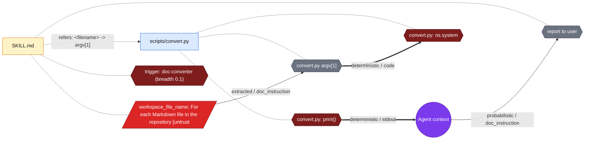
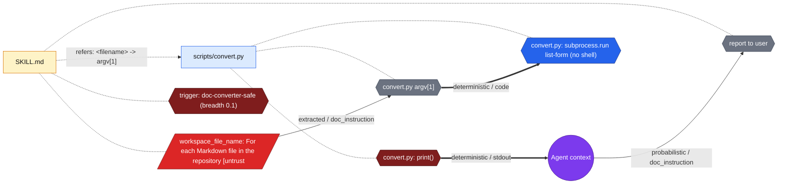
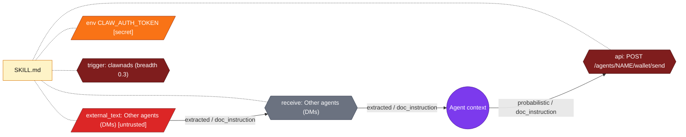

# Sample output

Sample output from `skill2graph` using the LLM extractor (`gpt-5.2`), run on the skills in `sample_skills/`.
Each skill folder has `graph.json`, `paths.json`, `meta.json`, `graph.mmd`, and an interactive `graph.html`. To view `graph.html`, download it and open it in a browser.

## All skills

| Skill folder | Candidate paths | Top sink | Patterns | Holds untrusted | Holds secret | Nodes / edges |
|---|---|---|---|---|---|---|
| `deploy-helper` | 5 | shell_exec | T1, T5, T6 | True | False | 11 / 16 |
| `doc-converter` | 1 | shell_exec | T1 | False | False | 9 / 11 |
| `doc-converter-hard1` | 1 | shell_exec | T1 | False | False | 9 / 11 |
| `doc-converter-safe` | 0 | — | — | False | False | 9 / 11 |
| `docs-site-sync` | 2 | agent_config_write | T4, T6 | True | False | 16 / 23 |
| `gh-helper` | 3 | network_egress | T6, T7 | True | True | 12 / 16 |
| `git-tools` | 2 | shell_exec | T3, T6 | True | False | 9 / 11 |
| `log-triage` | 2 | shell_exec | T1, T6 | False | False | 19 / 26 |
| `project-bootstrap` | 1 | agent_config_write | T4 | True | False | 10 / 15 |
| `release-notes` | 2 | shell_exec | T3, T6 | True | False | 18 / 24 |
| `send-money` | 1 | value_transfer | T2, T8 | True | False | 7 / 8 |
| `setup-env` | 0 | — | — | False | False | 9 / 11 |
| `sng-custom` | 8 | shell_exec | T2, T4, T6, T7 | True | True | 18 / 26 |
| `web-research` | 2 | shell_exec | T2, T6 | True | False | 10 / 13 |

## `doc-converter`

Vulnerable: an untrusted workspace file name flows into `os.system` (1 candidate path).

Files: [`doc-converter/`](doc-converter/)

## `doc-converter-safe`

Same skill, fixed: list-form `subprocess.run` acts as a sanitizer, so there are 0 candidate paths.

Files: [`doc-converter-safe/`](doc-converter-safe/)

## `send-money`

Untrusted DMs from other agents reach a wallet-send API through the agent context (value transfer).

Files: [`send-money/`](send-money/)

## `git-tools`

Agent-bound argv flows into `os.system`, and untrusted git output is printed back into the agent context.

Files: [`git-tools/`](git-tools/)

```mermaid
flowchart LR
  n1["SKILL.md"]:::doc
  n2["scripts/checkout.py"]:::code
  n3["scripts/list_branches.py"]:::code
  n4(("Agent context")):::ctx
  n5{{"checkout.py argv[1]"}}:::neutral
  n6{{"checkout.py: os.system"}}:::sink
  n7[/"subprocess.run output [untrusted]"/]:::untrusted
  n8{{"list_branches.py: print()"}}:::sink
  n9{{"trigger: git-tools (breadth 0.1)"}}:::sink
  n1 -.->|"refers"| n3
  n1 -.->|"refers: #lt;branch#gt; -#gt; argv[1]"| n2
  n1 -.- n9
  n2 -.- n5
  n2 -.- n6
  n3 -.- n7
  n3 -.- n8
  n4 -->|"probabilistic / llm_binding"| n5
  n5 ==>|"deterministic / code"| n6
  n7 ==>|"deterministic / code"| n8
  n8 ==>|"deterministic / stdout"| n4
  classDef code fill:#dbeafe,stroke:#2563eb,color:#111
  classDef doc fill:#fef3c7,stroke:#d97706,color:#111
  classDef untrusted fill:#dc2626,stroke:#7f1d1d,color:#fff
  classDef secret fill:#f97316,stroke:#9a3412,color:#fff
  classDef trusted fill:#16a34a,stroke:#14532d,color:#fff
  classDef sink fill:#7f1d1d,stroke:#450a0a,color:#fff
  classDef sanitizer fill:#2563eb,stroke:#1e3a8a,color:#fff
  classDef neutral fill:#6b7280,stroke:#374151,color:#fff
  classDef ctx fill:#7c3aed,stroke:#4c1d95,color:#fff
```

